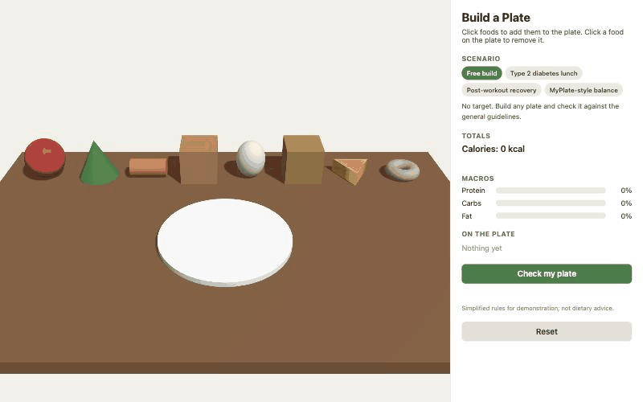

# Build a Plate

[](https://github.com/yhj3/3D_demo/actions/workflows/pages.yml)

A browser-based 3D nutrition-training activity: click foods onto a plate, watch calories and macros update live, pick a scenario such as *Type 2 diabetes lunch*, and check the plate against its goals.

**[Live demo](https://yhj3.github.io/3D_demo/)** · three.js · plain ES modules · no build step · zero dependencies



## Why

Hands-on nutrition education often uses a table of food models: learners build a plate, then a facilitator talks through what is on it. When a program moves from in-person instruction to virtual delivery, that exercise needs a browser-native equivalent. This project is a prototype of that exercise, the kind of activity a simulation-based health-worker curriculum might embed in a module. It is a portfolio piece, not a product: the goal was a convincing interactive loop built in an afternoon, with a structure that can grow.

## What it does

- **Build**: a 3D table with eight foods on a shelf. Click one and it drops onto the plate; click a plated food, or its row in the panel, to remove it.
- **See**: calories and the share of calories from protein, carbs and fat update on every change.
- **Practise**: four scenarios, each with its own goals. *Check my plate* scores the goals and shows the current value next to each one.
- **Learn**: plain-language coach notes (vegetables, protein, fat share, treats, total calories) appear in every scenario.

| Scenario | Goals |
|---|---|
| Free build | None; coach notes only |
| Type 2 diabetes lunch | at least 2 vegetables · carbs ≤ 45% of calories · no treats · ≤ 700 kcal |
| Post-workout recovery | protein ≥ 30% of calories · ≤ 800 kcal · at least 1 vegetable |
| MyPlate-style balance | half the items are produce · a grain, a protein and a dairy serving · fat ≤ 35% of calories |

## Run locally

```bash
python3 -m http.server 8000
```

Then open <http://localhost:8000>. Opening `index.html` directly as a file will not work: the page uses ES modules and `fetch`, which browsers block over `file://`. Any static file server is fine.

## Run the tests

```bash
node --test
```

Twelve tests (Node 18+, no packages to install) cover the spec's acceptance cases, the macro arithmetic, and every scenario's goals. They also validate that `scenarios.json` only references metrics and operators that exist, so a typo in a scenario fails CI instead of failing silently in the browser.

## How it works

| File | Role |
|---|---|
| `index.html` | Page shell, side panel markup, three.js import map |
| `style.css` | Canvas-plus-panel layout; stacks on narrow screens |
| `main.js` | Scene setup, raycast interaction, animations, panel updates |
| `rules.js` | Pure nutrition logic: totals, macro percentages, coach notes, scenario goals |
| `foods.json` | Food catalog: shape, colour, size, food group, nutrition per serving |
| `scenarios.json` | Scenarios and their goals |
| `tests/rules.test.js` | `node --test` suite for `rules.js` and the data files |

- **Scene**: a `PerspectiveCamera` with `OrbitControls`, a hemisphere fill plus a shadow-casting directional light, a wooden table and a white plate. Every food is a three.js primitive with a flat colour; the carrot is a cone on its side, the egg a stretched sphere, the cheese a three-sided cylinder.
- **Interaction**: one `Raycaster` on `pointerup`. A pointer that moved more than 5 px between down and up is an orbit drag, not a click, so rotating the camera never adds food. Hover is one raycast per animation frame and drives the highlight and tooltip.
- **Data-driven**: the shelf, the plate items, the panel and the scenario chips are all generated from the two JSON files. Adding a food or a scenario is a data change, not a code change.
- **Rules**: `rules.js` has no DOM or three.js imports, so the same functions run in the browser and under `node --test`. Scenario goals are declarative (`metric`, `op`, `value`) and evaluated generically.

## Design decisions

- **No bundler, no framework.** The spec required a page that runs from any static server and deploys unchanged to GitHub Pages. three.js from a pinned CDN import map does that, and the whole project stays readable in one sitting.
- **Primitives, not models.** Real food models would look better but would turn a two-hour prototype into an asset pipeline. Flat-coloured shapes keep the focus on the interaction loop.
- **Rules, not a model.** Feedback is an ordered list of simple, inspectable rules. For a training activity that is a feature: a facilitator can read, tweak and defend every sentence the tool produces.
- **Spec fidelity over tidiness.** The spec's coach notes show the first two rules that fire, in order. For a plate of only a donut and cheese, that means "no vegetables" and "protein is low" appear and the fat warning (53% of calories) does not, even though the spec's own acceptance list expects it. The behaviour follows the written rules and is pinned by a test; changing it is a one-line decision, documented here rather than made silently.
- **Placement without physics.** Each new item samples twelve random spots inside the plate and takes the one farthest from existing items. Cheap, deterministic enough, and it stops items stacking on top of each other.
- **One file became two.** The first version kept all logic in `main.js` under the spec's ~300-line budget. Scenarios pushed it past that, so the nutrition logic moved to `rules.js`, which also made it unit-testable without a browser.

## Known limitations

- Nutrition values are approximate single servings; there are no portion sizes.
- Hover highlights and tooltips need a pointer. On touch devices, tap foods to add them and use the panel list to remove them.
- The feedback rules are deliberately simple and are not dietary advice.

## Next steps

- Replace primitives with real food models (glTF) and add simple textures.
- Drag-and-drop placement, possibly with a lightweight physics step for settling.
- Portion sizes (half and double servings) and a per-item nutrition popover.
- A small scenario editor so facilitators can write goals without touching JSON.
- Port the scene to Unity WebGL for a richer training environment.

## Deploying

Pushing to `main` runs the tests and publishes the repository root to GitHub Pages through the workflow in `.github/workflows/pages.yml`. In the repository settings, set **Pages → Source** to **GitHub Actions** once.

## License

MIT. *Simplified rules for demonstration; not dietary advice.*
